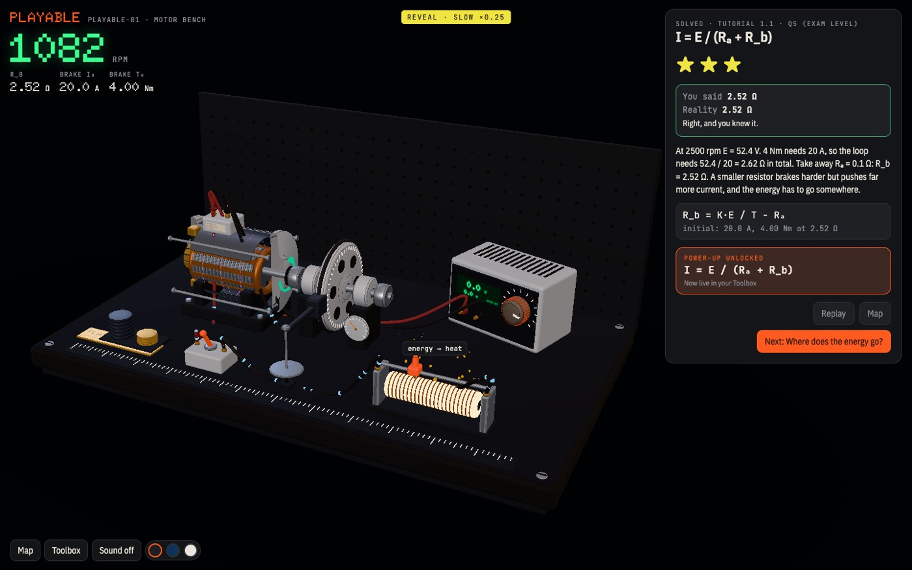
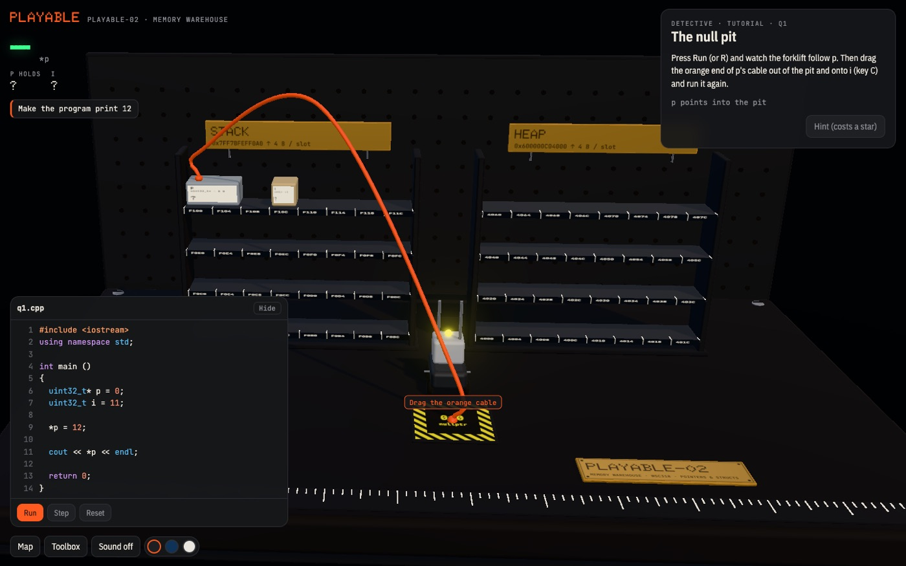
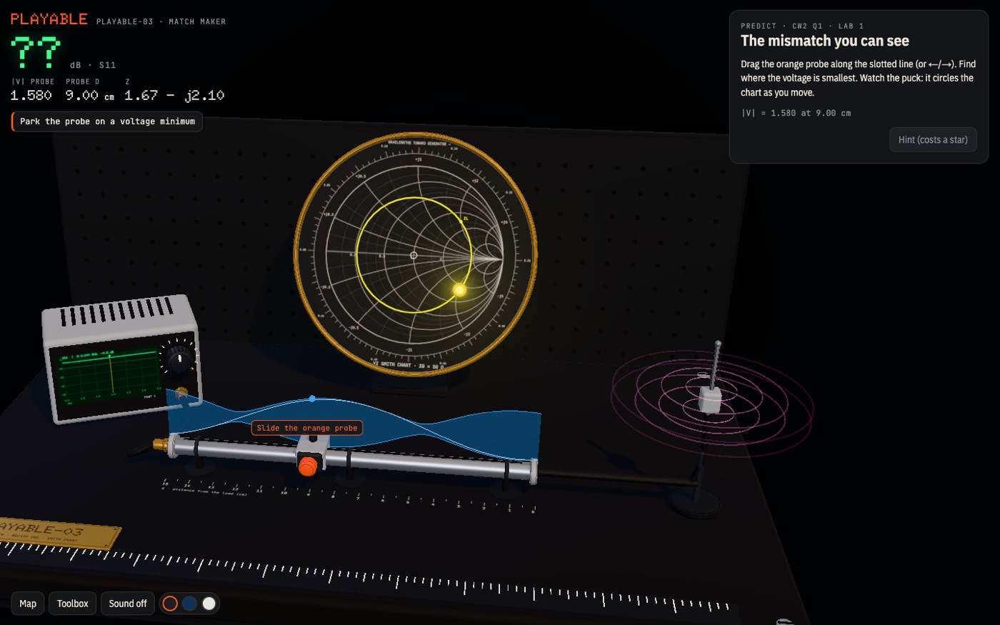
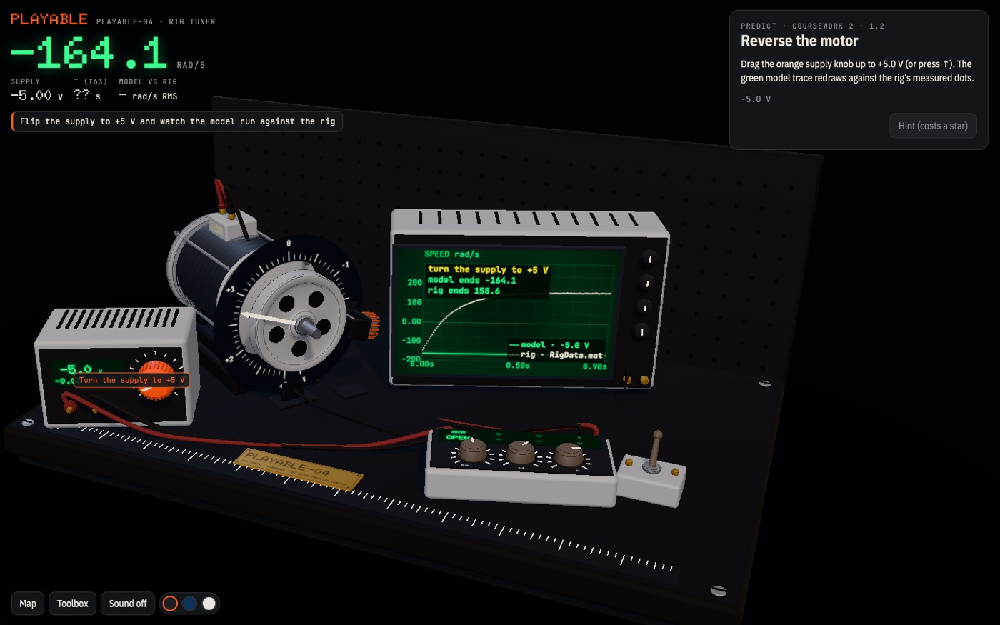

<div align="center">

# Playable

**Drop in your course. Play it.**

An agent skill that turns a lecture PDF, a tutorial sheet, coursework or a whole lab folder into a 3D game with real physics, sound and haptics, and checks every answer against your source before you see it.

[Play the games](https://alexbond008.github.io/playable/) · [Install](#install) · [How it works](#how-it-works)

<a href="https://alexbond008.github.io/playable/games/motor-bench.html"></a>

</div>

## Install

```bash
npx skills add alexbond008/playable
```

Works with Claude Code, Codex, Antigravity and OpenCode (add `-g -a claude-code`, `-a codex`, and so on to pick one). Or clone it into your skills folder:

```bash
git clone https://github.com/alexbond008/playable ~/.claude/skills/playable
```

Then ask your agent:

```
/playable turn my tutorial into a game: ~/uni/tutorial-1.pdf
```

Needs Node.js 20.10+ and Chrome or Chromium (for the playtest). Nothing to `npm install`.

## The collection

Every game here was built from real university course material, by an agent following [`SKILL.md`](SKILL.md). Each is a single offline HTML file.

| | Game | Built from | Checked |
|---|---|---|---|
| <a href="https://alexbond008.github.io/playable/games/motor-bench.html"></a> | **PLAYABLE-01 · Motor Bench**<br>Brushed DC motors: back-EMF, torque, efficiency, braking. 8 levels and a boss. | Tutorial 1.1, brushed DC motors | ✓ 8/8 answers verified |
| <a href="https://alexbond008.github.io/playable/games/memory-warehouse.html"></a> | **PLAYABLE-02 · Memory Warehouse**<br>C++ pointers and structs as a warehouse: crates sized in bytes, pointers as cables, padding as foam. | Embedded C++ tutorial | 58 reality checks with clang · your work: 4/7 right |
| <a href="https://alexbond008.github.io/playable/games/match-maker.html"></a> | **PLAYABLE-03 · Match Maker**<br>Impedance matching on a slotted line, a Smith chart and a VNA. | Microwaves coursework (CW2) | 61 reality checks · your work: 18/26 right |
| <a href="https://alexbond008.github.io/playable/games/rig-tuner.html"></a> | **PLAYABLE-04 · Rig Tuner**<br>Velocity and position control of a real motor rig: identify it, tune PI, add phase advance. | Control lab folder with the rig's measured data | 58 reality checks · your work: 2/14 right |

"Your work" is the student's own coursework answers, checked by the game. Where the answer sheet and the physics disagree, the game says so and shows why.

## How it works

1. **Read the source.** PDFs, Word (equations included), slides, spreadsheets, code, Simulink models, `.mat` data and whole lab folders. Every worked answer becomes a test case.
2. **Pass the truth gate.** The agent writes the physics model first. It must reproduce every official answer to the source's own decimals before any 3D exists. Code is compiled and run for real; data is fitted.
3. **Design the levels.** One concept per level. The mechanic *is* the concept: turning the supply knob *is* V = Kω + IR.
4. **Compose from the kit.** A hand-built three.js and Rapier kit: benches, motors, dynamometers, scopes, Smith charts, memory warehouses. New domains grow the kit.
5. **Playtest.** A headless bot plays every level on desktop and phone, drags every control, and fails the build on console errors or a blown frame budget.

The level loop is built on learning science: **mission → predict (and say how sure you are) → play → slow-motion reveal → the equation unlocks as a power-up → spaced recall days later.**

Three looks ship in every game: Bench (dark graphite), Cyanotype and Paper.

## Limits

- It teaches what is in your material and checks it against your answers. It does not do your problems for you.
- Building a game takes a while (a lesson is roughly one to two hours); the agent gives you an ETA up front. Playing it is instant and works offline.
- The kit starts with electrical, mechanical, control and embedded systems.
- Haptics use `navigator.vibrate`, so they work on Android, not iOS.

## Repository

| Path | What it is |
|---|---|
| [`SKILL.md`](SKILL.md) | The skill: the workflow the agent follows |
| [`references/kit.md`](references/kit.md) | The kit API: stage, parts, overlays, physics, the playtest contract |
| [`references/anti-patterns.md`](references/anti-patterns.md) | Every mistake so far and the rule it produced |
| [`kit/`](kit) | The engine and parts library, with three.js and Rapier vendored |
| [`scripts/`](scripts) | `ingest`, `verify-model`, `build`, `playtest`, `site` (all zero-dependency Node) |
| [`examples/`](examples) | The four games: lesson, model, checks and source code |
| [`PLAN.md`](PLAN.md), [`ART_DIRECTION.md`](ART_DIRECTION.md), [`ANATOMY_ANALYSIS.md`](ANATOMY_ANALYSIS.md) | Design notes |

Rebuild and test an example:

```bash
node scripts/build.mjs examples/motor-bench
```

```bash
node scripts/playtest.mjs examples/motor-bench
```

Inspired by [Anatomy](https://github.com/wheresryan22/anatomy).

## License

[MIT](LICENSE) © 2026 Aleks Gornik. three.js and Rapier keep their own licenses, in [`kit/vendor/`](kit/vendor).
